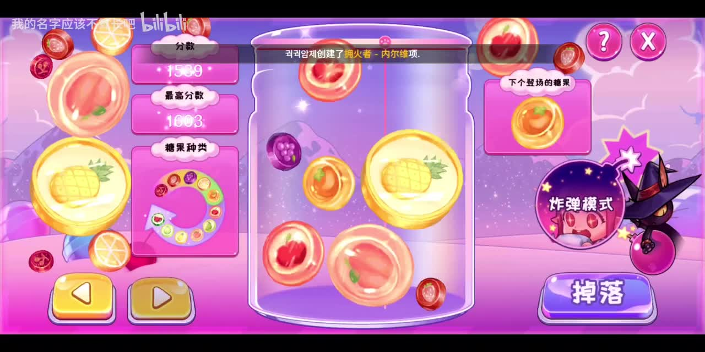

# Candy Fusion · 水果糖果合成

一款计划在微信小游戏平台免费公开游玩的横屏休闲游戏：左右调整落点，释放晶莹的水果糖果，让相同等级的糖果碰撞合成更大的糖果，在瓶子被填满前争取更高分。

项目参考 DNF 手游中的水果糖果合成休闲玩法，目前处于需求与视觉方向整理阶段，**尚未实现可运行的游戏**。Candy Fusion 为项目暂定名。



> 图片和视频来自用户提供的原游戏录像，用于玩法与视觉沟通，不是本项目的运行截图或正式美术素材。

## 已确定的方向

- **平台与定位**：微信小游戏，横屏，免费公开游玩。
- **核心操作**：左、右按钮调整掉落位置，独立的“掉落”按钮释放糖果。
- **核心玩法**：同级糖果接触后合成下一级；通过重力、圆形碰撞、弹跳和滚动形成堆积与连续合成。
- **一局目标**：合成获得积分，瓶内堆积达到结束条件后结算，支持再次挑战。
- **美术方向**：粉紫色糖果世界、透明瓶子、包着水果切片的透明糖果，配合可爱的高光、星星与合成反馈。

## 文档入口

| 文档 | 用途 |
| --- | --- |
| [简版 PRD](docs/PRD.md) | 产品目标、首版范围、核心流程和验收方向 |
| [设计与开发 Brief](docs/BRIEF.md) | 画面、布局、操作手感和实现注意事项 |
| [参考素材说明](docs/references/README.md) | 原视频、截图、关键时间点及使用边界 |

## 当前仓库内容

```text
README.md
docs/
  PRD.md
  BRIEF.md
  references/
    README.md
    dnf-candy-fusion-reference.mp4
    screenshots/
      gameplay.jpg
      merge-order.jpg
      game-over.jpg
```

当前没有引擎工程、依赖清单、运行命令或自动化测试。引擎、物理库和工程结构将在技术方案阶段确定，不能将文档中的体验目标视为已经实现的功能。

## 参与开发

1. 先阅读 PRD 和 Brief，再查看参考视频中的操作与合成片段。
2. 优先完成能在微信开发者工具中试玩的普通模式原型，验证落点控制、碰撞、合成和结束重玩。
3. 用原型确定物理参数、尺寸梯度和判输规则，再完善原创美术及音效。
4. 技术选型完成后补充实际的安装、运行、测试和真机验证步骤；确定新规则时同步更新文档。

尚未确定的规则集中列在 PRD 中，可在设计和试玩中落实，不要求现在一次性决定。首版建议不加入广告、付费、联网排行榜和炸弹模式；这些是范围建议，不代表用户已对所有后续功能作出决定。

## 素材与发布

参考录像与截图只用于说明目标体验，不能据此认为已获得原游戏素材的发布授权。正式游戏使用原创或明确获授权的图片、角色、字体和音效；参考素材不进入小游戏发行包。项目尚未指定开源许可证，免费游玩不等同于代码或素材可任意再分发。
