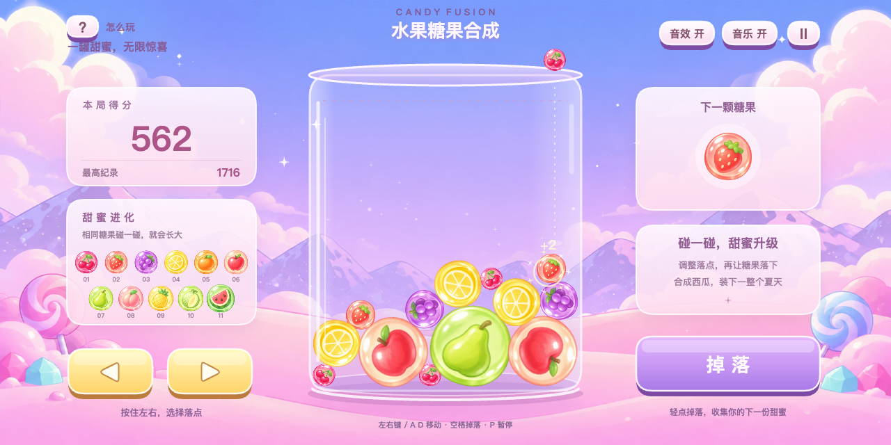

# Candy Fusion · 水果糖果合成

一款横屏水果糖果物理合成小游戏，采用 **TypeScript + Canvas 2D + Matter.js**。浏览器与微信小游戏共用玩法和画面，免费游玩的首版已实现。



上图为本项目运行截图；下方 `docs/references` 中的 DNF 录像和截图仅作为目标体验参考，不进入发行包。

当前画面为 **v3软萌手绘版本**：根据新增参考截图，使用奶油色透明糖衣、圆润手绘水果与粉紫卡通雪山背景。保留上一轮的水果辨识度、音频、物理修复和5%尺寸微调；素材与生成提示词见 [ART-V3](docs/ART-V3.md)。

## 开始试玩

Node.js 固定为 **24.22.1**。已安装 nvm 时：

```sh
nvm install
nvm use
npm ci
npm run dev
```

浏览器打开终端显示的地址，默认 `http://127.0.0.1:5173/`。手机网页需横屏，竖屏时对局暂停。

- 按住画面左右按钮或键盘 `←` / `→` / `A` / `D` 调整位置。
- 点击“掉落”，或按空格 / Enter 投放糖果。
- 同级碰撞合成下一等级；最大西瓜保持，不再升阶。
- `P` / Escape 暂停或继续；`R` 重新开始。结算后点击“再装一罐”。
- 顶部可查看玩法，分别开关音效、音乐，或暂停。切后台后需要主动继续。

## 微信开发者工具

```sh
npm run build:wechat
```

导入 **`dist/wechat`**，选择小游戏项目。本机已配置正式小游戏账号，成功上传 `0.1.0` 并设为好友体验版，受邀账号已确认可玩。尚未提交审核或公开上架。

AppID 保存在 Git 忽略的 `wechat/project.local.config.json`；仓库模板使用 `testappid` 占位。其他电脑需要配置自己的小游戏 AppID，或在工具中点击“测试号”分配测试身份。配置方法见 [开发文档](docs/DEVELOPMENT.md)，体验版和公开发布流程见 [发布说明](docs/RELEASE.md)。

## 已实现

- 11 级原创水果糖果，下一颗预览、半径限制落点和投放冷却。
- 固定 60 Hz 物理步长、重力、碰撞、旋转、滚动及连续合成。
- 接触队列延后处理、每颗糖果单步只合成一次、瓶壁与瓶底边界约束。
- 合成计分、本机最高分、持续超线判输、结算、重开和暂停。
- 原创 GPT Image 背景与透明糖果图集，Canvas 分层玻璃瓶、亮面按钮、星光特效。
- 浏览器 / 微信平台接口、ElevenLabs 生成的投放/合成/结算音效、32秒纯音乐、微信轻震动、多点触控及可选桌面鼠标键盘。
- 音效和音乐独立开关，首次交互后启动；暂停、切后台时停止音乐，回到游戏再继续。
- 微信构建只携带正式素材，移除调试映射，并检查 4 MiB 主包预算。

无后端、广告、付费、联网排行榜或炸弹模式。当前最高分只保存在本机；未实现退出后恢复未结束对局。

## 首版可调规则

所有数值都是本项目原型设计，不宣称是参考视频的准确参数。定义在 `src/config.ts`：

| 项目 | 当前规则 |
| --- | --- |
| 等级链 | 樱桃 → 草莓 → 葡萄 → 柠檬 → 蜜橘 → 苹果 → 青梨 → 蜜桃 → 菠萝 → 哈密瓜 → 西瓜 |
| 随机投放 | 前 4 级，权重 40 / 30 / 20 / 10 |
| 合成得分 | 生成第 2 级得 2 分，此后逐级翻倍；投放不计分 |
| 投放冷却 | 0.45 秒 |
| 判输 | 新投放糖果有 1.2 秒宽限；成熟糖果可见顶部持续超出警戒线 2 秒后结束 |
| 最大等级 | 两颗西瓜继续正常碰撞，不消除、不升阶 |
| 暂停 | 切后台自动暂停，返回后点击继续；竖屏网页暂停且屏蔽操作 |

## 检查与验证

```sh
npm run typecheck
npm test
npm run build
```

物理测试覆盖多点接触去重、连锁计分、最大等级、判输宽限、暂停、固定步长、重开和三个种子的密集堆积全局流程。微信入口冒烟检查在没有浏览器 DOM 的 VM 中执行真实打包代码，覆盖绘制、输入、安全区、音效调用与生命周期。

浏览器已实际检查按钮和键盘投放、合成计分、暂停、横屏缩放及最高分保存。微信小游戏已完成正式账号上传和好友体验版配置，用户确认手机与体验版可玩。跨机型的音频、性能、安全区及长时间试玩仍需持续验证；具体记录见开发文档。

## 文档

- [开发、构建与 AppID](docs/DEVELOPMENT.md)
- [好友体验与发布](docs/RELEASE.md)
- [PRD](docs/PRD.md)
- [画面与手感 Brief](docs/BRIEF.md)
- [原创素材、图集坐标与生成提示词](docs/ASSETS.md)
- [当前软萌手绘水果糖设计](docs/ART-V3.md)
- [v2辨识度设计归档](docs/ART-V2.md)
- [音效、背景音乐与手机音频修复](docs/AUDIO.md)
- [参考录像与截图说明](docs/references/README.md)

## 素材与发布

正式图片采用内置 GPT Image Tool 生成，提示词与检查记录见素材文档；按钮、玻璃瓶及特效为代码绘制，音效和背景音乐通过 StarT MCP → fal → ElevenLabs 生成。DNF 参考文件不进入游戏包。免费游玩不等同于代码或素材可任意再分发，项目尚未指定开源许可证。公开发布所需主体、类目与审核条件应以实际微信后台为准。


## 物理修复与轻微难度调整

修复了糖果合并后，上方已休眠糖果不随支撑变化掉落的问题。Matter.js 会跳过休眠刚体的重力更新，移除旧支撑不自动唤醒上层；现在每批合并后统一唤醒剩余糖果，使整堆重新自然下落。平时仍使用休眠优化。

加入了自然休眠后失去支撑、以及多层堆叠连带掉落两个回归场景，修复前能稳定复现悬空，修复后均通过。全仓17项测试通过，密集堆积测试延长了允许的试玩步数，继续验证边界、最终判输和结果冻结。

按试玩反馈，`CANDY_SIZE_SCALE = 1.05` 将糖果半径统一放大5%，占地面积约增加10.25%；瓶子、分数、投放权重、投放节奏与判输时间不变。可以继续根据手机试玩调整这个单独的尺寸系数。
